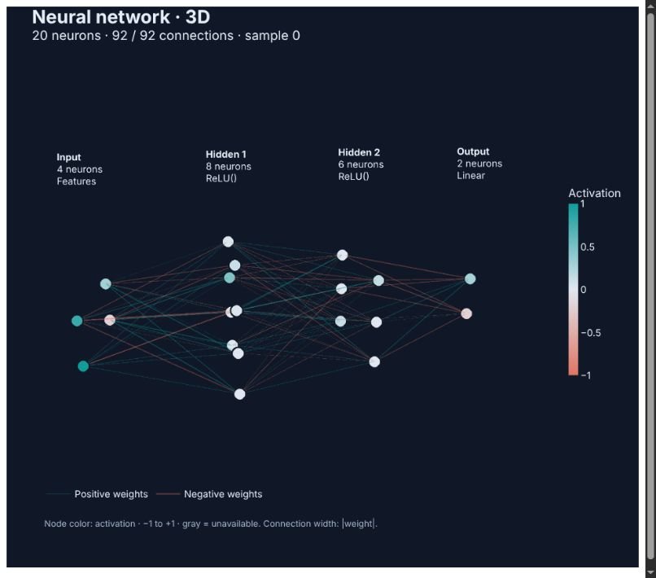
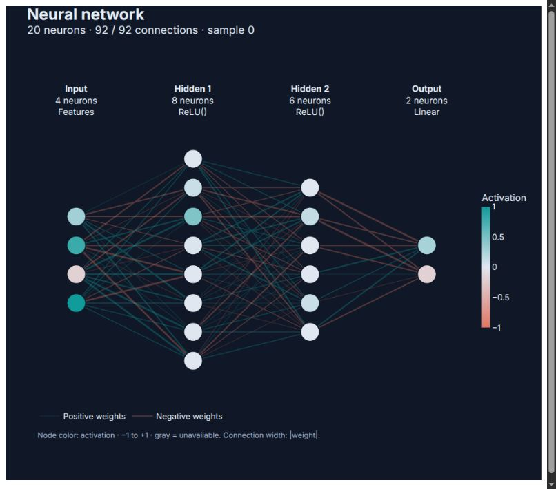
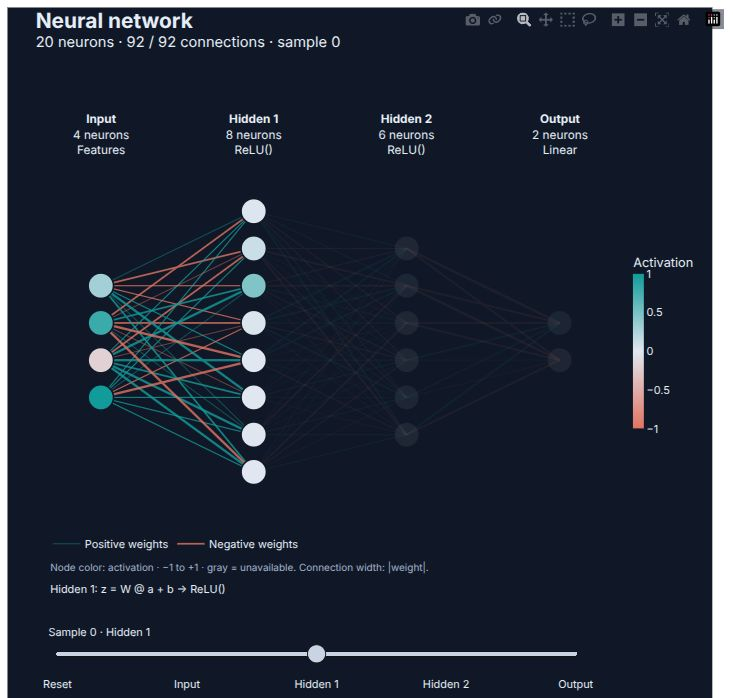
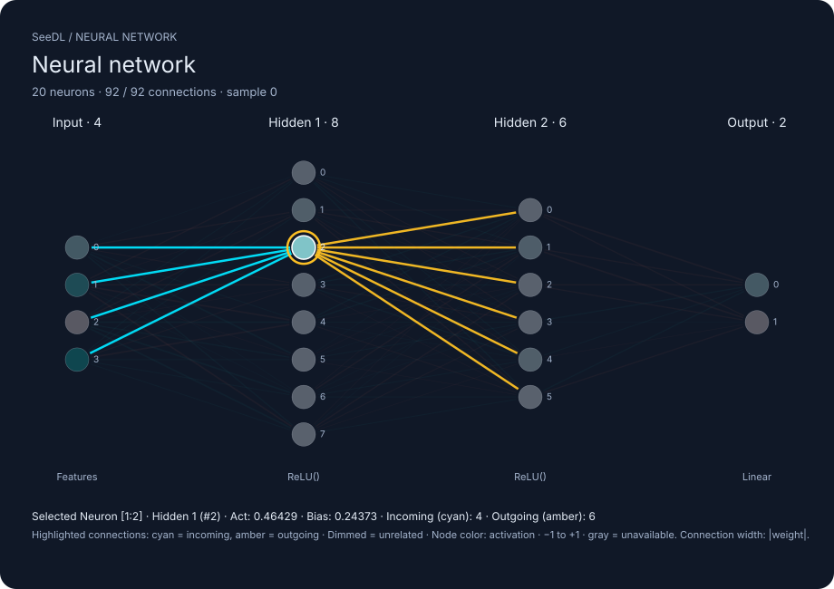
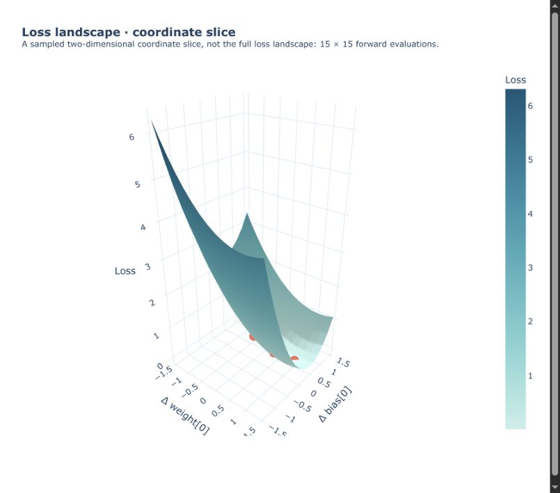
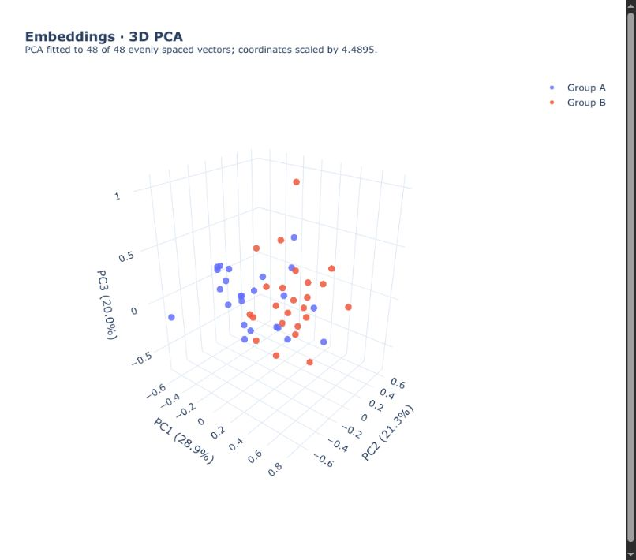

<div align="center">

# 🧠 SeeDL

### Don't just train neural networks or run quantum circuits. **See them.**

**The next-generation scientific visualization library for classical neural networks and quantum systems.**

[](https://github.com/iamaritrasaha/seedl/actions/workflows/ci.yml)
[](https://github.com/iamaritrasaha/seedl/blob/main/pyproject.toml)
[](LICENSE)
[-blueviolet)](https://github.com/iamaritrasaha/seedl)
[](https://pytorch.org/)
[](https://qiskit.org/)
[](https://plotly.com/python/)

<br>

<p align="center">
  <a href="#-quickstart"><b>⚡ Quickstart</b></a> &nbsp;•&nbsp;
  <a href="#-why-seedl"><b>✨ Why SeeDL?</b></a> &nbsp;•&nbsp;
  <a href="#-interactive-visual-gallery"><b>🎨 Visual Gallery</b></a> &nbsp;•&nbsp;
  <a href="#-flagship-features"><b>🚀 Flagship Features</b></a> &nbsp;•&nbsp;
  <a href="#-the-complete-toolkit"><b>🔬 Complete Toolkit</b></a> &nbsp;•&nbsp;
  <a href="#-scientific-rigor--integrity"><b>🛡️ Scientific Rigor</b></a> &nbsp;•&nbsp;
  <a href="#-documentation"><b>📚 Docs</b></a>
</p>

<sub>Zero required dependencies for the pure Python SVG core • Optional integrations for PyTorch, NumPy, Plotly, Matplotlib & Qiskit</sub>

<br>
<br>

<a href="#-interactive-visual-gallery">
  
</a>

<p align="center">
  <i>Real neurons. True signed synaptic weights. Live captured activations. Interactive 3D WebGL camera controls.</i>
</p>

</div>

<br>

```python
import seedl as sd
import torch.nn as nn
from qiskit import QuantumCircuit

# 1. Interactive 3D Neural Networks (orbit, pan, zoom & click neurons)
model = nn.Sequential(nn.Linear(2, 3), nn.ReLU(), nn.Linear(3, 1))
sd.see(model, view="3d")

# 2. Interactive 3D Bloch Sphere
sd.bloch("+")

# 3. Quantum Circuit Diagram & Evolution
qc = QuantumCircuit(2)
qc.h(0)
qc.cx(0, 1)
sd.see(qc)

# 4. Bipartite Entanglement & von Neumann Entropy
bell_state = [1 / (2**0.5), 0, 0, 1 / (2**0.5)]
sd.entanglement(bell_state)
```

> [!NOTE]
> **SeeDL 0.2.0**: Unifies classical deep learning and quantum information visualization in a single lightweight library.
> Install the full interactive 3D and quantum suite:
> `pip install "seedl[quantum,plotly]"` or `pip install "seedl[all]"`

---

## 0.3.0 development — unreleased

The package version remains **0.2.0**. Development functionality now includes bounded recording of real PyTorch training passes, 3D training playback with loss and gradient inspection, aligned before/after snapshot comparison, and quantum gate-by-gate before/after state inspection.

Use `with sd.watch(model) as run:` (or `sd.track`) and call `run.capture(step=..., epoch=..., loss=loss)` **after forward/backward and before `optimizer.step()`**. `run.playback()` / `sd.see(run)` provide inline playback; `.save("training.html")` exports offline controls. Compare retained observations with `sd.compare(run.snapshots[0], run.snapshots[-1])`. Quantum playback uses `sd.circuit(qc, simulate=True)` and marks post-measurement/reset states unavailable.

See the [API, bounds and limitations](docs/live-neural-intelligence.md) and [runnable MLP / quantum example](examples/live_neural_intelligence.py). Snapshot count, retained bytes and HTML payloads are bounded; missing data stays unavailable. New CNN feature-explorer controls are deferred.

---

## ✨ Why SeeDL?

Most scientific and machine learning visualization tools either generate **static boxes of abstract module containers** (like Netron), spit out **dense ASCII tables of parameter tallies** (like TorchInfo), or rely on static text-based circuit printers.

**SeeDL is fundamentally different.** It brings your classical models and quantum states to life by visualizing the **actual mathematical reality** — rendering individual neurons, true synaptic connection weights ($W_{ij}$), live tensor activations, and forward computation flows alongside rigorous 3D Bloch spheres, quantum circuits, and von Neumann entanglement metrics in responsive 2D and 3D WebGL.

| Capability | Traditional Tools | **SeeDL** |
| :--- | :--- | :--- |
| **Neuron Granularity** | Abstract layer boxes or tensor shapes | **Individual neurons** mapped to matrix rows & columns |
| **Direct 3D Interaction** | Static viewpoints or hover menus only | **Direct viewport clicking** on neurons with camera preservation |
| **Connection Weights** | Hidden inside opaque state dictionaries | **True signed synaptic weights** scaled by magnitude and sign |
| **Live Activations** | Requires writing custom forward hooks | **Automatic telemetry capture** with `input=x` |
| **Spatial 3D CNNs** | Flattened feature plots | **3D stacked spatial planes** preserving channel structure |
| **Interactive 3D** | Static 2D PNG diagrams | **Full WebGL 3D orbit, pan, zoom & reset** via Plotly |
| **Forward Propagation** | Mental abstraction | **Interactive playback animation** with speed controls & layer stepping |
| **Quantum States** | Text notation or static projection | **Interactive 3D Bloch sphere** for pure ($r=1$) and mixed ($r<1$) states |
| **Quantum Circuits** | ASCII terminals or matplotlib figures | **Interactive circuit diagrams** with unitary evolution stepping |
| **Entanglement Diagnostics** | Manual partial trace calculations | **Automated partial trace & von Neumann entropy** ($S=1.0$ bit for Bell) |
| **Portability** | Requires running Python kernels or servers | **Self-contained HTML exports** & zero-dependency SVG engine |

---

## 🎨 Interactive Visual Gallery

Every visualization below is generated by **SeeDL** directly from real PyTorch models and evaluated tensors — **no pre-baked mockups or conceptual artwork.**

<table>
  <tr>
    <td width="50%" align="center"><b>🎮 Interactive 3D Neural Network</b></td>
    <td width="50%" align="center"><b>📐 Precision 2D Synaptic Graph</b></td>
  </tr>
  <tr>
    <td>
      <a href="docs/visuals/network-3d.jpg">
        
      </a>
    </td>
    <td>
      <a href="docs/visuals/network-2d.jpg">
        
      </a>
    </td>
  </tr>
  <tr>
    <td align="center"><sub>Rotatable Plotly 3D WebGL with planar layer boundaries and camera presets</sub></td>
    <td align="center"><sub>Signed synaptic connections: green/blue for positive weights, red/pink for negative</sub></td>
  </tr>
  <tr>
    <td width="50%" align="center"><b>🎬 Forward Propagation Animation</b></td>
    <td width="50%" align="center"><b>🔍 Neuron-Level Dendrite Inspection</b></td>
  </tr>
  <tr>
    <td>
      <a href="docs/visuals/forward-step.jpg">
        
      </a>
    </td>
    <td>
      <a href="docs/visuals/neuron-selected.svg">
        
      </a>
    </td>
  </tr>
  <tr>
    <td align="center"><sub>Step-by-step layer activation playback with Play/Pause, speed controls, and slider</sub></td>
    <td align="center"><sub>Cyan incoming connections, amber outgoing connections, and real parameter HUD</sub></td>
  </tr>
  <tr>
    <td width="50%" align="center"><b>⛰️ 3D Loss Landscapes</b></td>
    <td width="50%" align="center"><b>🌌 3D Latent Embeddings (PCA)</b></td>
  </tr>
  <tr>
    <td>
      <a href="docs/visuals/loss-slice.jpg">
        
      </a>
    </td>
    <td>
      <a href="docs/visuals/embeddings-3d.jpg">
        
      </a>
    </td>
  </tr>
  <tr>
    <td align="center"><sub>Sampled 2D parameter-slice surfaces with optimum markers and contour maps</sub></td>
    <td align="center"><sub>Interactive dimensional reduction with cluster labels and variance metrics</sub></td>
  </tr>
</table>

<p align="center">
  <b>Explore specialized architectures:</b> 
  <a href="docs/visuals/cnn.jpg">CNN Feature Maps</a> • 
  <a href="docs/visuals/transformer.jpg">Transformer Attention Hierarchy</a> • 
  <a href="docs/visuals/medium-3d.jpg">Deep Networks in 3D</a> • 
  <a href="docs/visuals/svg-fallback.jpg">Pure SVG Fallback</a>
</p>

---

## ⚡ Quickstart

### 1. Installation

```bash
# Recommended for Quantum + 3D WebGL:
pip install "seedl[quantum,plotly]"

# Recommended for Deep Learning + 3D WebGL:
pip install "seedl[torch,plotly]"

# Complete Scientific Suite:
pip install "seedl[all]"

# Lightweight core engine (Pure Python, zero third-party dependencies):
pip install seedl
```

Or using **[uv](https://github.com/astral-sh/uv)**:

```bash
uv add "seedl[quantum,plotly]"
uv add "seedl[torch,plotly]"
```

<details>
<summary><b>🛠️ Clone for local development</b></summary>

```bash
git clone https://github.com/iamaritrasaha/seedl.git
cd seedl
uv sync --extra dev --extra all
uv run --extra dev --extra all pytest
```

</details>

<br>

### 2. From Zero to 3D in 30 Seconds

```python
import torch
from torch import nn
import seedl as sd

# 1. Define any standard PyTorch neural network
model = nn.Sequential(
    nn.Linear(4, 8),
    nn.ReLU(),
    nn.Linear(8, 6),
    nn.ReLU(),
    nn.Linear(6, 2),
)

# 2. Provide a sample input tensor
x = torch.tensor([[0.5, -0.2, 1.4, -0.8]])

# 3. See your network!
sd.see(model)  # Clean 2D architecture diagram
sd.see(model, view="3d")  # Interactive 3D WebGL model
sd.see(model, input=x)  # Colors neurons by live activation responses
sd.see(model, input=x).explore()  # Step through computation layer-by-layer
```

### 3. Export & Share Anywhere

```python
view = sd.see(model, input=x, view="3d")

# Save as a standalone, self-contained HTML file (zero server required!)
view.save("my_neural_network.html")

# Or save as a lightweight vector SVG
sd.see(model, backend="svg").save("architecture.svg")
```

> [!TIP]
> Exported HTML files bundle Plotly's rendering engine and network coordinates. You can email them to teammates, upload them to S3, or embed them in slide decks — anyone can orbit and inspect the network in their browser with **no Python installation needed**.

---

## 🚀 Flagship Features

### 🔍 1. Direct 3D Neuron Selection & Dendrite Inspection

Hovering gives you quick stats, but **clicking a neuron unlocks deep-dive telemetry directly in the 3D viewport**. You can click any neuron directly with your mouse in standalone HTML or notebook environments, or select via code and dropdown menus:

```python
# Direct 3D network exploration:
view = sd.see(model, input=x, view="3d")
# Click any neuron marker directly to isolate its connections and update HUD!

# Or programmatically select neuron index 2 in hidden layer 1:
view = sd.see(model, input=x, select_neuron=(1, 2), view="3d")
```

<div align="center">
  
</div>

- **Direct Viewport Interaction**:
  - Click any neuron marker in the 3D scene to isolate its local dendritic neighborhood.
  - **Camera Preservation**: Clicking a neuron preserves your current orbit and pan camera orientation without jumping.
  - Click the empty background to clear selection and restore the full network overview.
- **Isolated Synaptic Wiring**:
  - **Incoming Connections**: Highlighted in vivid cyan (`#00e5ff`, width 3.5, opacity 0.95).
  - **Outgoing Connections**: Highlighted in warm amber (`#fbbf24`, width 3.5, opacity 0.95).
  - **Unrelated Network**: Dimmed to 0.04 opacity so you can trace information flow instantly without visual clutter.
  - **Target Node**: Highlighted with a luminous gold halo ring.
- **Parametric HUD Inspection Card**:
  - Module name and mathematical operation (e.g. $z = W \cdot a + b \rightarrow \text{ReLU}()$).
  - Actual bias value and parameter status (`trainable` vs `frozen`).
  - True post-activation value and pre-activation ($z$) value for the chosen batch sample.
  - Parameter gradient availability and values.
  - Comprehensive sorted lists of incoming and outgoing connection weights.

---

### 🎬 2. Forward Propagation Animation Engine

Understand how inputs transform into representations across depth. By calling `.explore()`, SeeDL launches an interactive playback studio:

```python
sd.see(model, input=x, view="3d").explore()
```

<div align="center">
  
</div>

- **Full Playback Controls**:
  - **▶ Play**: Automatically steps computation forward layer by layer.
  - **⏸ Pause**: Freezes playback at any layer to allow manual inspection.
  - **⏮ Reset**: Restores the global network overview.
  - **Speed Presets**: Toggle between **0.5x**, **1x**, and **2x** animation speeds.
  - **Layer Scrubber**: Bidirectionally scrub through `Input` $\rightarrow$ `Hidden 1` $\rightarrow$ `Hidden 2` $\rightarrow$ `Output`.
- **Live Activation Telemetry**: As the animation advances, neurons light up with their actual recorded activation values, showing saturation and dead units clearly.

---

### 🌐 3. True 3D WebGL Architecture Exploration & Themes

SeeDL's 3D engine is powered by Plotly WebGL scatter and mesh primitives, built specifically for spatial intuition:

- **Optimal Default Perspective**: Opens with an ergonomic camera angle (`eye=(-1.8, -2.4, 0.85)`), providing immediate depth, clear layer spacing, and unoccluded connections.
- **One-Click Camera Controls**: Dedicated camera menu to trigger automated 360° **Orbit**, switch to planar **Pan**, or **Reset view** back to home coordinates.
- **Planar Layer Guides**: Dotted bounding boxes define layer boundaries in 3D space without obstructing connection sightlines.
- **5 Scientific Themes**: `scientific` (deep space navy default), `dark`, `light`, `minimal`, and `presentation`.

---

### 🖼️ 4. 3D Spatial CNN Feature Map Stacks

For convolutional neural networks, SeeDL captures intermediate activations via PyTorch forward hooks and renders them as stacked 3D spatial planes along the depth axis:

```python
# Pass any convolutional model and an image tensor:
sd.see(cnn_model, input=image_tensor, view="3d")
```

- **Spatial Coordinate Planes**: Feature map channels are preserved as $(H, W)$ 2D grids stacked across layer depth.
- **Activation Intensity Mapping**: Pixel markers reflect true forward-pass feature activations with continuous teal/viridis colormaps.
- **Architecture Flow**: Inter-layer bounding boxes show receptive field downsampling and channel expansion.

---

### ⚛️ 5. The Quantum Revolution: Quantum System Diagnostics

SeeDL 0.2.0 introduces a comprehensive quantum visualization subsystem with verified mathematical rigor:

#### Interactive 3D Bloch Sphere
Visualize any single-qubit statevector or density matrix with exact Cartesian coordinates $r_i = \text{Tr}(\rho \sigma_i)$:

```python
# Pure states (r = 1.0) on the sphere surface:
sd.bloch([1 / 2**0.5, 1 / 2**0.5])  # |+> state on +X axis
sd.bloch([1 / 2**0.5, 1j / 2**0.5])  # |+i> state on +Y axis

# Mixed states (r < 1.0) inside the sphere:
rho_mixed = [[0.75, 0.0], [0.0, 0.25]]
sd.bloch(rho_mixed)  # Bloch vector length r = 0.5 inside sphere
```

#### Quantum Circuits & State Evolution
Render interactive circuit diagrams and track unitary evolution step-by-step:

```python
from qiskit import QuantumCircuit

qc = QuantumCircuit(2)
qc.h(0)
qc.cx(0, 1)

# Interactive circuit diagram with statevector evolution tracking:
sd.circuit(qc, simulate=True)
```

#### Bipartite Entanglement Diagnostics
Diagnose quantum correlations using automated partial traces and von Neumann entropy:

```python
# Analyze a Bell pair (|00> + |11>) / sqrt(2):
bell = [1 / 2**0.5, 0.0, 0.0, 1 / 2**0.5]
sd.entanglement(bell)
# Yields exact von Neumann entropy: S(ρ_A) = 1.0000 bit (Maximally Entangled)
```

---

## 🔬 The Complete Toolkit

SeeDL is more than a multilayer perceptron viewer. It is a unified visual diagnostic suite for deep learning:

<details open>
<summary><b>📊 Tensors, Activations & Gradient Health</b></summary>

```python
import seedl as sd

# Visualize 1D vectors, 2D weight matrices, or image tensors
sd.see(my_tensor)

# Inspect all layer activations from a forward pass:
sd.activations(model, input=x)

# Diagnose gradient health (vanishing / exploding gradients) after loss.backward():
loss.backward()
sd.gradients(model)
```

</details>

<details>
<summary><b>📈 Training Progress & Run Comparison</b></summary>

```python
# Lightweight in-memory training metric tracker:
tracker = sd.watch(name="experiment_resnet")
tracker.log(epoch=1, loss=0.82, accuracy=0.64)
tracker.log(epoch=2, loss=0.55, accuracy=0.79)
sd.see(tracker)

# Compare multiple training runs side-by-side with automatic smoothing:
sd.compare(
    {"epoch": [1, 2, 3], "loss": [0.82, 0.55, 0.38]},
    {"epoch": [1, 2, 3], "loss": [0.90, 0.68, 0.52]},
    names=("AdamW (lr=1e-3)", "SGD (lr=1e-2)"),
)
```

</details>

<details>
<summary><b>🧠 Explainability & Attribution (XAI)</b></summary>

```python
# Saliency maps (vanilla backpropagation):
sd.explain(model, input=x, method="saliency")

# Integrated Gradients (path-integrated attribution):
sd.explain(model, input=x, method="integrated_gradients", steps=30)
```

</details>

<details>
<summary><b>🎯 Attention Maps & Model Predictions</b></summary>

```python
# Self-attention & cross-attention token heatmaps:
sd.attention(
    attention_matrix,
    tokens=["The", "neural", "network", "learns", "features"],
)

# Multi-class prediction probabilities with target highlighting:
sd.predictions(
    logits_or_probs=[2.8, -0.4, 0.1, 1.2],
    labels=["airplane", "automobile", "bird", "cat"],
    task="classification",
)
```

</details>

<details>
<summary><b>⛰️ 3D Loss Landscapes & Latent Manifolds</b></summary>

```python
# Evaluate a 2D parameter slice around current weights:
sd.loss_landscape(
    model,
    (x_batch, y_batch),
    loss_fn=nn.functional.cross_entropy,
    axes=(("weight", 0), ("bias", 0)),
    radius=1.5,
    steps=20,
    evaluate=True,  # Explicitly opt-in to loss surface evaluation
)

# 3D PCA dimensional reduction on hidden embeddings:
embeddings = torch.randn(64, 128)
sd.embeddings(embeddings, dimensions=3)
```

</details>

<details>
<summary><b>🎓 Interactive Deep Learning Lessons</b></summary>

Learn or teach fundamental machine learning mechanics through interactive simulations:

```python
sd.learn("gradient_descent", lr=0.1, steps=15)
sd.learn("backpropagation")
sd.learn("activation_functions")
sd.learn("loss_functions")
sd.learn("attention")
sd.learn("convolution")
```

</details>

---

## 🛡️ Scientific Rigor & Integrity

SeeDL is engineered by scientists and engineers who value **truthful representation** over flashy illusions:

1. **True Weights, Not Random Lines**: Synaptic connections represent genuine `model[layer].weight[out, in]` scalar values. Edge color corresponds strictly to sign, and stroke thickness reflects normalized absolute magnitude.
2. **Real Activations, Not Decorative Colors**: When passing `input=x`, neuron node colorings reflect the exact floating-point tensor values captured by forward hooks during inference.
3. **Computation Flow, Not "Particle Physics"**: Animation highlights denote the sequential order of matrix operations and activation functions. SeeDL will never render misleading particles or arbitrary pulses that misrepresent mathematical reality.
4. **Zero Model State Tampering**: When capturing activations or evaluating loss surfaces, SeeDL never mutates model parameters, device placement, or train/eval modes. Loss evaluations are performed safely under `torch.no_grad()` on explicitly cloned state copies.
5. **Honest Architectural Fallbacks**:
   - Supported feedforward networks receive full neuron-level visualization.
   - Convolutional networks (CNNs) display operation blocks with tensor channel dimensions.
   - Transformers and arbitrary DAGs display verified module hierarchy trees rather than guessing unprovable execution paths.
6. **Graceful Large-Network Scaling**: Networks exceeding 100 neurons or 1,500 connections are automatically protected by deterministic sampling limits with transparent disclosures in the visualization header.

---

## 📦 Rendering Backends

| Backend | Interactivity | Ideal Use Case | Dependencies |
| :--- | :--- | :--- | :--- |
| **`Plotly`** *(Default)* | Full (3D WebGL, Orbit, Pan, Zoom, Hover, Dropdowns, Animation) | Jupyter notebooks, web dashboards, standalone `.html` exports | `plotly` |
| **`SVG`** | Static (Vector graphics, crisp typography, responsive scaling) | Documentation, print, papers, lightweight environments | **Zero** (Pure Python Standard Library) |
| **`Matplotlib`** | Static (Publication figures, image pipelines) | Academic papers, raster PNG export, LaTeX embedding | `matplotlib` |

```python
# Choose your backend explicitly:
sd.see(model, backend="plotly")  # Interactive Plotly WebGL
sd.see(model, backend="svg")  # Pure Python vector SVG
sd.see(model, backend="matplotlib")  # Publication-ready Matplotlib plot
```

---

## 📚 Documentation & Resources

- **[Official Website & Playground](website/README.md)**: Local preview, reproducible SeeDL 0.2.0 demos, documentation, and manual GitHub Pages deployment.
- **[Interactive Showcase Notebook](examples/neural_network_explorer.ipynb)**: Complete, cell-by-cell walkthrough demonstrating 2D/3D networks, neuron selection, forward exploration, loss landscapes, and embeddings.
- **[Advanced 3D & Quantum Showcase](examples/advanced_3d_quantum_showcase.ipynb)**: Deep-dive notebook demonstrating direct 3D neuron selection, CNN spatial maps, 3D Bloch spheres, quantum circuit evolution, Bell state entanglement, and density matrices.
- **[Visual Acceptance Specification](docs/VISUAL_ACCEPTANCE.md)**: Comprehensive verification criteria, tested architectures, and capability boundaries.
- **[Examples Directory](examples/)**:
  - [`01_quickstart.py`](examples/01_quickstart.py): Zero-to-one API overview.
  - [`02_model_and_training.py`](examples/02_model_and_training.py): Model inspection, metrics, and training loops.
  - [`04_explainability_and_predictions.py`](examples/04_explainability_and_predictions.py): Interpretability and attributions.
- **[Release Notes](docs/RELEASE_NOTES_0.1.0.md)**: Version 0.1.0 changelog, design decisions, and roadmap.

---

## 🛠️ Contributing & Development

We welcome contributions, bug reports, and suggestions from the deep learning community!

```bash
# Clone repository
git clone https://github.com/iamaritrasaha/seedl.git
cd seedl

# Install development environment with uv
uv sync --extra dev --extra all

# Run test suite across CPU environment
uv run --extra dev --extra all pytest

# Code quality and static typing checks
uv run --extra dev ruff check .
uv run --extra dev ruff format --check .
uv run --extra dev mypy

# Validate build distributions
uv build --no-sources
```

---

<div align="center">

### Built for curious minds creating the future of deep learning.

If SeeDL gives you clarity into your models, please consider giving the project a ⭐ **[Star on GitHub](https://github.com/iamaritrasaha/seedl)**!

<br>

**[GitHub Repository](https://github.com/iamaritrasaha/seedl)** &nbsp;•&nbsp; 
**[Issue Tracker](https://github.com/iamaritrasaha/seedl/issues)** &nbsp;•&nbsp; 
**[Discussions](https://github.com/iamaritrasaha/seedl/discussions)** &nbsp;•&nbsp; 
**[MIT License](LICENSE)**

<sub>© 2026 SeeDL Contributors. Distributed under the permissive MIT License.</sub>

</div>
