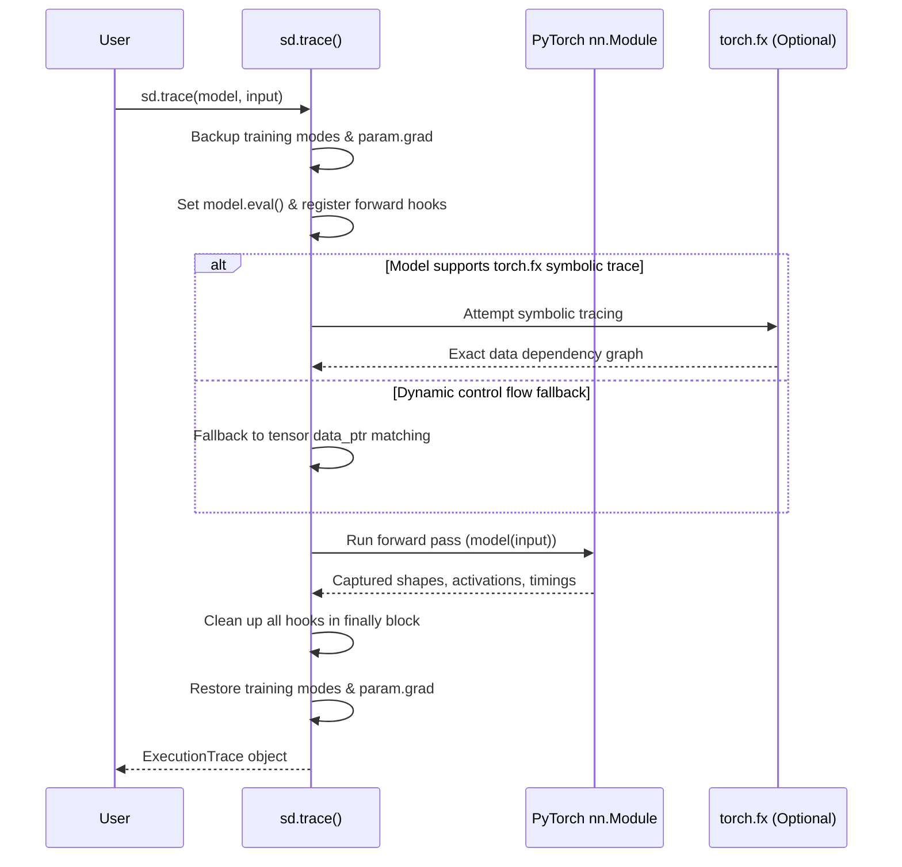

# Neural Execution Tracer & Interactive Tensor Flow Explorer

## 1. Overview & Motivation

Understanding how tensors transition through a modern deep neural network—especially complex models containing residual blocks, multi-branch routing, normalization layers, and reused submodule instances—is difficult when relying solely on static code analysis.

The **Neural Execution Tracer** (`sd.trace()`) and **Interactive Tensor Flow Explorer** (`sd.flow()`) solve this by observing real forward execution in PyTorch models without modifying model parameters or optimizer state.

---

## 2. API Reference

```python
import seedl as sd

trace = sd.trace(
    model,
    input=example_input,
    record=("shapes", "activations", "timing"),
    max_nodes=256,
    max_tensor_samples=64,
)

view = sd.flow(trace, backend="auto")
# Or view directly via SeeDL's unified dispatcher:
sd.see(trace, view="flow")
```

### Parameters for `sd.trace`
- `model`: Any PyTorch `nn.Module`.
- `input`: Example input tensor, tuple, or dictionary matching the model's forward signature.
- `record`: Tuple of attributes to record. Options:
  - `"shapes"`: Records input and output tensor shapes and number of elements.
  - `"activations"`: Computes bounded activation statistics (mean, std, min, max, sparsity, nonfinite count, sampled values).
  - `"timing"`: Measures wall-clock execution duration per module.
- `max_nodes`: Maximum number of operations/modules to record (default: 256).
- `max_tensor_samples`: Maximum elements sampled for histogram rendering in the inspector (default: 64).

---

## 3. How It Works: Hybrid Dynamic Tracing + `torch.fx`



### Data Dependency Detection
1. **Symbolic Resolution (`torch.fx`)**: For traceable models, exact data dependencies (including non-module in-place operations) are captured symbolically.
2. **Dynamic Tensor Matching (`data_ptr`)**: When dynamic Python control flow prevents symbolic tracing, SeeDL matches output tensor storage pointers (`tensor.data_ptr()`) to downstream module inputs to build verified data dependency edges.
3. **Zero Fabrication**: If dependencies between modules cannot be established empirically, SeeDL reports them as sequential invocations without inventing speculative connections.

---

## 4. Interactive Flow Explorer Interface

When rendered in a browser or notebook (`sd.flow()`), SeeDL produces an offline self-contained HTML workbench featuring four interactive tabs:

1. **Flow Graph Tab**: Interactive execution graph showing inputs, residual paths, intermediate transformations, and output nodes. Clicking any node immediately displays its full statistics in the inspector panel.
2. **Timeline Tab**: Chronological waterfall chart showing execution order, relative wall-clock duration, and latency bottlenecks.
3. **Tensor Table Tab**: Full tabular breakdown of all observed tensor shapes, element counts, dtypes, devices, parameters, and sparsity.
4. **Summary Tab**: High-level execution metrics, trainable vs non-trainable parameter counts, and diagnostic warnings.
5. **Real-time Filter & Search**: Search modules by name, type, or toggle between leaf modules and high-level containers.

---

## 5. State Preservation Guarantees

- **No Parameter Alteration**: Existing weights, biases, and buffer tensors are never updated.
- **Gradient Preservation**: Any existing `param.grad` tensors from prior backward passes are backed up and restored.
- **Hook Cleanup**: Hooks are registered with temporary tokens and removed inside a strict `try...finally` block, ensuring no persistent hooks remain even if the forward pass raises an exception.
