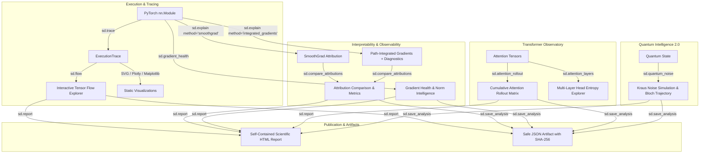

# SeeDL 0.5.0 — The Neural Observatory: Architectural Blueprint & User Guide

## 1. Vision & Core Philosophy

**SeeDL 0.5.0 ("The Neural Observatory")** represents a major leap forward in scientific AI visualization, deep learning interpretability, and quantum state investigation. 

Unlike conventional deep-learning visualization libraries that rely on synthetic or declarative module diagrams, SeeDL operates as a **true scientific instrument**. It directly observes:
1. **Actual tensor transformations** during forward execution.
2. **True gradient dynamics** across parameter graphs without corrupting autograd state.
3. **Rigorous information routing** in transformer architectures via Attention Rollout.
4. **Empirical feature attributions** backed by mathematical completeness diagnostics.
5. **Open quantum systems** undergoing decoherence governed by Completely Positive Trace-Preserving (CPTP) Kraus maps.
6. **Self-contained offline scientific reports** formatted for publication and archival reproducibility.



---

## 2. Architectural Pillars

### A. Non-Negotiable Invariants
1. **Zero Mandatory Runtime Dependencies**: Works in any standard Python 3.10–3.13 installation. Optional libraries (`torch`, `numpy`, `plotly`, `matplotlib`, `qiskit`) are detected lazily with graceful fallbacks.
2. **Strict State Preservation**: Hooks are guaranteed to be cleaned up in `try...finally` blocks. Model `training` mode, parameter gradients (`param.grad`), model buffers, and user input tensors are never mutated or permanently modified.
3. **Offline-First & Air-Gapped Security**: All HTML visualizations and scientific reports contain zero external network calls (no CDNs, Google Fonts, or remote scripts). All user-controlled strings, layer names, and tokens are rigorously escaped against adversarial XSS injection.
4. **Zero Fabrication**: If tensor dependencies cannot be established with empirical certainty (e.g. dynamic non-traceable Python control flow), SeeDL will never invent speculative edges.

---

## 3. Module Inventory & Key APIs

| Feature Area | Module | Primary Public APIs |
| :--- | :--- | :--- |
| **Execution Tracing** | `src/seedl/_trace.py`, `_execution_graph.py` | `sd.trace(model, input=...)` |
| **Tensor Flow Explorer** | `src/seedl/_flow.py`, `_trace_renderers.py` | `sd.flow(trace)` |
| **Transformer Rollout** | `src/seedl/_transformer_observatory.py` | `sd.attention_rollout(...)`, `sd.attention_layers(...)` |
| **Advanced Explainability** | `src/seedl/_explain.py`, `_explain_compare.py` | `sd.explain(..., method="smoothgrad" \| "integrated_gradients")`, `sd.compare_attributions(...)` |
| **Gradient Intelligence** | `src/seedl/_gradient_health.py` | `sd.gradient_health(model)` |
| **Quantum Intelligence** | `src/seedl/_quantum_lab.py` | `sd.quantum_noise(channel=..., param=...)` |
| **Dataset Drift** | `src/seedl/_dataset_health.py` | `sd.dataset_drift(ref, comp)`, `sd.dataset_health(data)` |
| **Scientific Reports** | `src/seedl/_reports.py` | `sd.report(...)`, `ScientificReport` |
| **Safe Artifacts** | `src/seedl/_serialization.py` | `sd.save_analysis(viz, path)`, `sd.load_analysis(path)` |
| **Training Run Compare** | `src/seedl/_training_compare.py` | `sd.compare_runs(run_a, run_b)` |

---

## 4. Quick Start Example

```python
import torch
import torchvision.models as models
import seedl as sd

# 1. Trace execution of a ResNet
model = models.resnet18(weights=None)
example_input = torch.randn(1, 3, 224, 224)

trace = sd.trace(model, input=example_input)
flow = sd.flow(trace)

# 2. Inspect gradient health
x = torch.randn(1, 3, 224, 224)
loss = model(x).sum()
loss.backward()

health = sd.gradient_health(model)

# 3. Assemble publication report
report = sd.report(
    title="ResNet-18 Architecture & Gradient Diagnostics",
    views=[flow, health],
    author="Observatory Team",
    theme="dark",
)
report.save("resnet_observatory_report.html")
```
