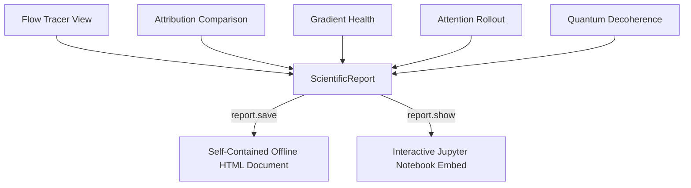

# The Scientific Report Builder (`sd.report`)

## 1. Overview

Sharing research findings often requires piecing together disparate screenshots, terminal logs, and notebook cells. The **Scientific Report Builder** (`sd.report()`) enables researchers to combine multiple SeeDL visualizations, diagnostic analyses, narratives, and provenances into a single, publication-grade offline HTML document.



---

## 2. Key Features

- **Multi-Section Organization**: Group figures into numbered, structured sections with introductory narratives and technical notes.
- **Dynamic Table of Contents**: Automatically generated sidebar TOC with smooth navigation links.
- **Light / Dark Theme Toggle**: Built-in CSS variables supporting dark mode (default) and paper-style light mode, with print stylesheets optimized for PDF export.
- **Strict Air-Gapped Security**: Zero CDN dependencies. All CSS, JavaScript, and SVG vector graphics are bundled inline.
- **Robust XSS Immunity**: All user-provided titles, abstracts, author names, and figure summaries are safely HTML-escaped.
- **Configurable Size Limits**: Bounded payload sizes (`max_size_mb`) ensure reports open quickly and never crash web browsers.

---

## 3. API Reference

```python
import seedl as sd

# Method 1: Shorthand report assembly
report = sd.report(
    title="Vision Transformer Layer Analysis",
    views=[flow_view, rollout_view, health_view],
    subtitle="Model Checkpoint: Epoch 40",
    abstract="Evaluating attention concentration and gradient norms in ViT-B/16.",
    author="Scientific AI Laboratory",
    affiliation="Research Center",
    theme="dark",
    max_size_mb=25.0,
)

# Method 2: Detailed multi-section building
builder = sd.report(title="Deep Network Audit")
builder.add_section(
    title="Forward Execution & Tensor Transformations",
    views=[flow_view],
    narrative="The model completes 34 operations with significant channel expansion at layer 3.",
    notes=["Input dimension: [1, 3, 224, 224]", "Peak activation sparsity: 42%"],
)
builder.add_section(
    title="Attention Rollout Across Transformer Blocks",
    views=[rollout_view],
    narrative="Rollout demonstrates persistent attention to the [CLS] token starting at layer 6.",
)

# Export to offline HTML
output_file = builder.save("vit_audit_report.html")
print(f"Report saved to: {output_file}")
```

---

## 4. Archival and Print Specifications

When printed or saved as PDF (`Ctrl+P` in any modern web browser), the report's print media stylesheet:
- Hides the sidebar navigation and interactive controls.
- Forces a clean white paper background with crisp black typography.
- Uses `break-inside: avoid` to keep figure cards and captions intact across page breaks.
- Preserves full vector resolution for SVG diagrams.
