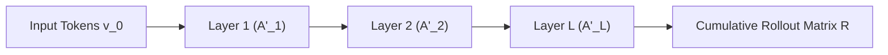

# Transformer Observatory 2.0: Attention Rollout & Multi-Layer Flow

## 1. Overview & Motivation

Self-attention mechanisms in Transformers (BERT, GPT, ViT, LLaMA) compute token-to-token attention weights independently at each layer. However, in deep transformers, representations from input tokens mix across successive layers.

Inspecting raw attention maps from an individual layer fails to reveal how information flowed from the original input tokens to the final representations. **Attention Rollout** solves this by tracking the cumulative flow of information through the entire depth of the network.

---

## 2. Mathematical Derivation of Attention Rollout

Let $A_l \in \mathbb{R}^{N \times N}$ be the row-stochastic attention matrix at layer $l \in \{1, \dots, L\}$, where $N$ is the sequence length. In standard self-attention:
$$\sum_{j=1}^N A_{l, ij} = 1.0$$

### Incorporating Residual Connections
In transformer architectures, every attention layer includes a residual skip connection:
$$X_l = X_{l-1} + W_{\text{att}} X_{l-1}$$
Assuming equal weighting between identity flow and attention updates, the effective token propagation matrix $A'_l$ is:
$$A'_l = 0.5 \times (A_l + I)$$
Each row of $A'_l$ is re-normalized to maintain row-stochasticity ($\sum_j A'_{l, ij} = 1.0$).

### Multi-Head Aggregation
Before layer rollout, multiple attention heads $H$ at layer $l$ are aggregated via:
- **Mean Reduction**:
  $$\bar{A}_l = \frac{1}{H} \sum_{h=1}^H A_{l, h}$$
- **Min Reduction**: Focuses on consensus connections across all heads.
- **Max Reduction**: Emphasizes dominant routing paths across any head.

### Cumulative Matrix Rollout Order
Because token representations evolve forward as $v_l = A'_l v_{l-1}$, information from the original input $v_0$ reaches layer $L$ through the cumulative matrix product:
$$R_1 = A'_1$$
$$R_l = A'_l \times R_{l-1}$$
$$R = A'_L \times A'_{L-1} \times \dots \times A'_1$$



---

## 3. Usage & Examples

### Cumulative Attention Rollout (`sd.attention_rollout`)

```python
import torch
import seedl as sd

# attention_tensors can be:
# - A 4D tensor: [num_layers, num_heads, seq_len, seq_len]
# - A list of 3D tensors: [[num_heads, seq_len, seq_len], ...]
# - A list of 2D matrices: [[seq_len, seq_len], ...]

tokens = ["[CLS]", "The", "neural", "observatory", "reveals", "hidden", "flow", "[SEP]"]
attn_tensors = torch.softmax(torch.randn(12, 8, 8, 8), dim=-1)

viz = sd.attention_rollout(
    attn_tensors,
    tokens=tokens,
    include_residual=True,
    head_reduction="mean",
)
```

### Multi-Layer Attention Explorer (`sd.attention_layers`)

Inspect individual heads, per-layer attention entropy, and dispersion across depth:

```python
viz_layers = sd.attention_layers(
    attn_tensors,
    tokens=tokens,
)
```

### Layer Attention Entropy
For an attention row $p_i$, the Shannon entropy (in bits) measures whether attention is concentrated on a single token or dispersed uniformly:
$$H(p_i) = - \sum_{j=1}^N p_{ij} \log_2(p_{ij})$$
Lower entropy indicates sharp, focused token routing; higher entropy indicates diffuse context gathering.

---

## 4. Scientific Boundaries & Limitations

- **Not Causal Proof**: Attention weights reflect information routing capacity, not counterfactual feature necessity. A high rollout score from token $A$ to token $B$ demonstrates strong structural paths, but downstream non-linear MLPs can suppress or transform those signals.
- **Value Vectors ($V$)**: Standard rollout tracks query-key weights ($QK^T$). Value vector magnitudes and projection matrices are not reflected in pure attention rollout.
