# Developer experience overhaul: delivery and verification

See the [initial audit](AUDIT.md) for observed problems on `main` at `01ff054`.
No version bump, release, merge or website publication is part of this change.

## Implementation and files

| Area | Files and decisions |
| --- | --- |
| Discovery | `cli.py`, `__main__.py`, `_discovery.py`, `__init__.py`, `pyproject.toml`: argparse console/module entry points, one categorized catalog, live Python signatures/docstrings, `guide()`, runnable examples and a labeled offline UCI Iris demo. Standard library only; no mandatory dependencies. |
| Text | `_presentation.py`, `view.py`, `api.py`: aligned metadata, captured values, layer tables, existing findings first, explicit nonfinite/unavailable values, configurable width/detail and ASCII fallback. Preserve original data/metadata/notes and implicit terminal summaries; suppress unchanged SVG `.show()` repeats. |
| Charts and export | `renderers.py`, `_export.py`, `_tensor_explorer.py`, `_gradient_health.py`: responsive SVG/HTML, readable small matrices with values/indices/Viridis scale, mobile semantic data tables, text alternatives, tensor slice range disclosures, keyboard cell inspection, corrected Viridis controls, significant-digit slice statistics, escaped gradient parameter/layer names. |
| Shared typography | `_typography.py`, package/website font assets, `MANIFEST.in`, `AGENTS.md`, renderer font declarations, website CSS/generator: Google Sans UI and JetBrains Mono monospace. OFL licenses and provenance included. No CDN; lazy bundled fonts, embedding at HTML/SVG export and notebook boundaries, TTF registration for optional Matplotlib. Raw SVG figures remain compact. |
| Onboarding | Short `README.md`; `CLI.md`, `GETTING_STARTED.md`, `TYPOGRAPHY.md`; extended pre-overhaul README retained as `REFERENCE.md` with moved links corrected. No public operation or advanced parameter removed. |
| Validation | `test_developer_experience.py`, `test_dx_browser.py`, `scripts/verify_dx_visuals.py`, these audit/validation documents and screenshot comparisons. Existing tests retained. |

Specialized scientific HTML/SVG engines keep their controls and user themes.
The neuron-graph Plotly export retains its established full-viewport scene:
wrapping it in a narrower card changed pointer/camera geometry during testing.
Fonts are added without moving that scene. Shared HTML treatment is applied to
the common paths, with focused changes to tensor and gradient surfaces.

## Terminal before and after

Before, on `main`:

```text
$ python -m seedl
No module named seedl.__main__; 'seedl' is a package and cannot be directly executed
```

After (default guide; plain, non-TTY output):

```text
SeeDL | Scientific visualization in Python

Get started
  seedl help [api]               Discover Python APIs and read function help
  seedl list                     Browse capabilities by task
  seedl doctor                   Check Python and optional integrations
  seedl examples [topic]         Print copyable Python examples
  seedl demo [--output FILE]     Export labeled UCI Iris example data offline

In Python
  import seedl as sd
  view = sd.see([[1, 2], [3, 4]], backend="svg")
  view.show()
  view.save("result.html")
```

Before, inspecting the authentic Iris excerpt:

```text
Numeric matrix: Matrix with shape (5, 4)
```

After, the same values:

```text
Numeric matrix
==============
Matrix with shape (5, 4)

Summary
  Shape  (5, 4)

Values
  row 0: [5.1, 3.5, 1.4, 0.2]
  row 1: [4.9, 3, 1.4, 0.2]
  row 2: [4.7, 3.2, 1.3, 0.2]
  row 3: [4.6, 3.1, 1.5, 0.2]
  row 4: [5, 3.6, 1.4, 0.2]
```

Activation excerpt from the same seeded model and measured Iris inputs:

```text
Sequential activations
======================
Captured 4 module activation(s)

CAUTION: Dead unit alert (heuristic): 1 activation layer(s) have >80% inactive zeros: 1.
         Note: observed response pattern on this input, not a permanent diagnosis.
CAUTION: Saturation detected in 1 layer(s): 1

Layers
name    type        shape   status     mean      std      max_abs   finite
(root)  Sequential  (5, 1)  available  -0.39141        0  0.391409     yes
0           Linear  (5, 3)  available  -0.41556  0.24996  0.807113     yes
1             ReLU  (5, 3)  available         0        0         0     yes
2           Linear  (5, 1)  available  -0.39141        0  0.391409     yes
```

Capture/provenance notes follow this excerpt. These are existing engine
observations, not new thresholds or claims that a neuron is permanently dead.

## Visual comparisons

Reproduce with `python scripts/verify_dx_visuals.py --output /tmp/seedl-dx` after
installing NumPy, CPU PyTorch, Playwright and Chromium. For before screenshots,
run the same script with `PYTHONPATH` pointing at `01ff054`'s `src` directory.
Inputs, seed and viewport are identical. Values come from the explicitly
attributed UCI Iris excerpt; attention examples are explicitly synthetic and
the quantum example is the analytic `+` state.

| View | Before | After |
| --- | --- | --- |
| Matrix, 390 px | 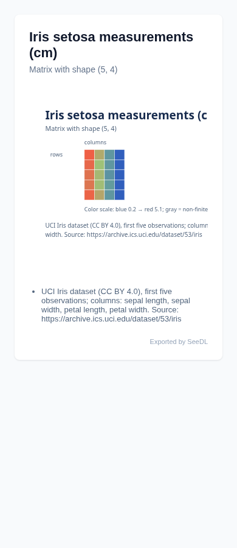 | 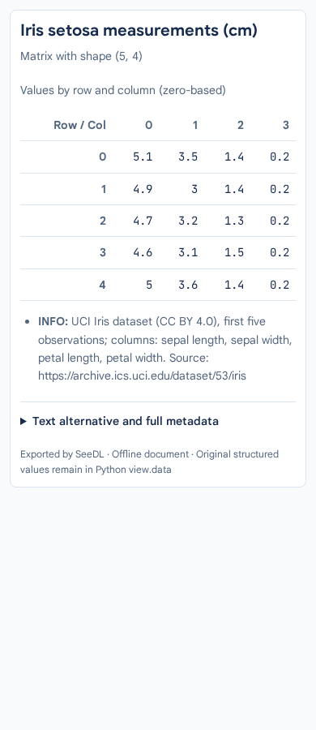 |
| Matrix, 1280 px | 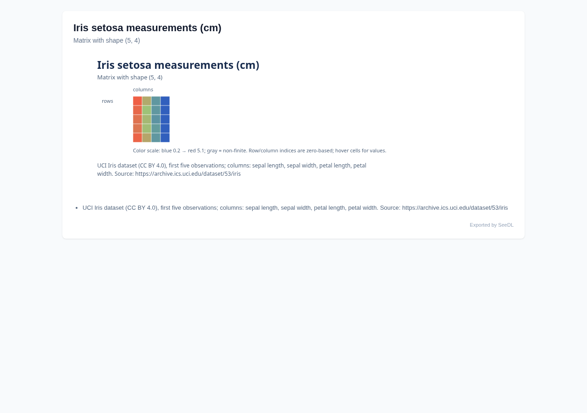 | 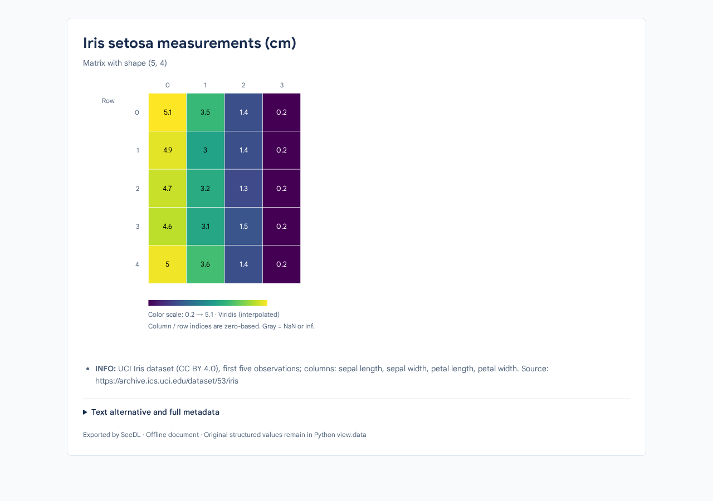 |
| Tensor, 390 px | 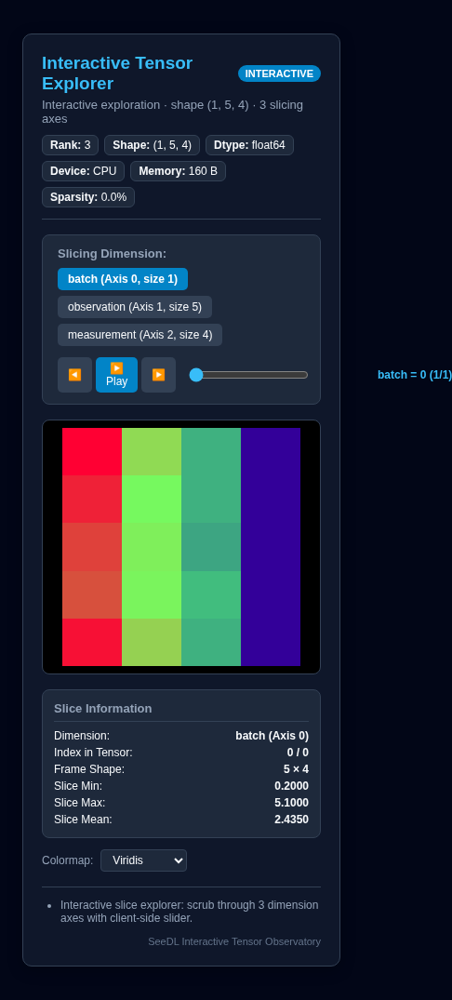 | 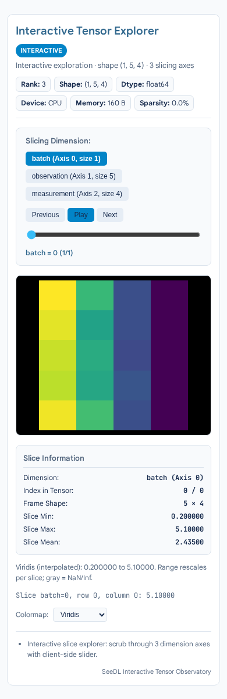 |
| Tensor, 1280 px | 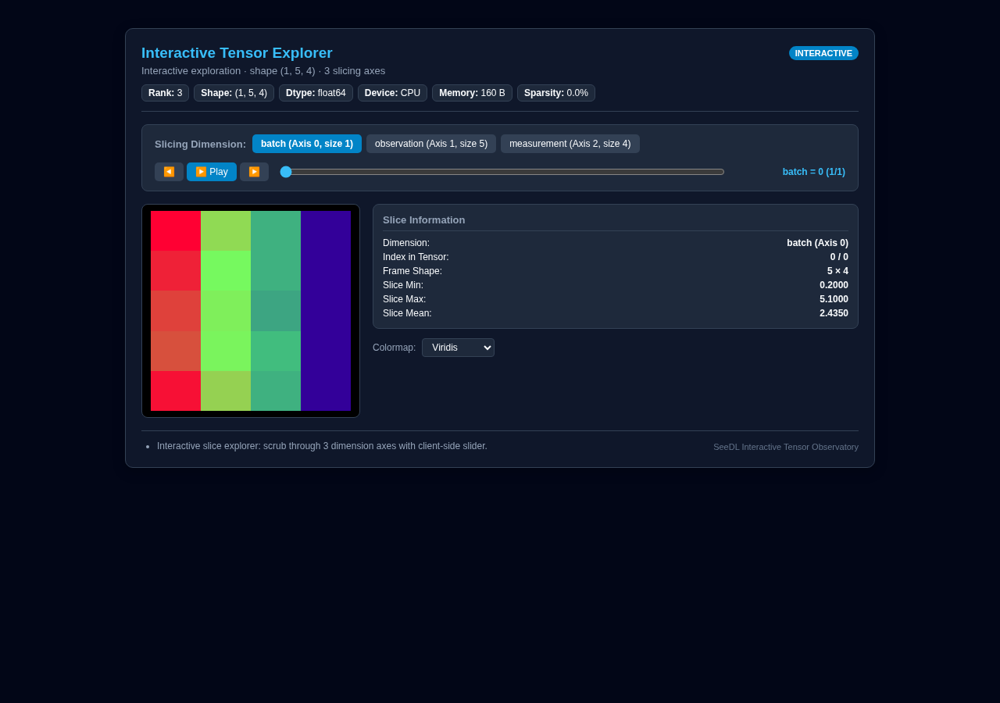 | 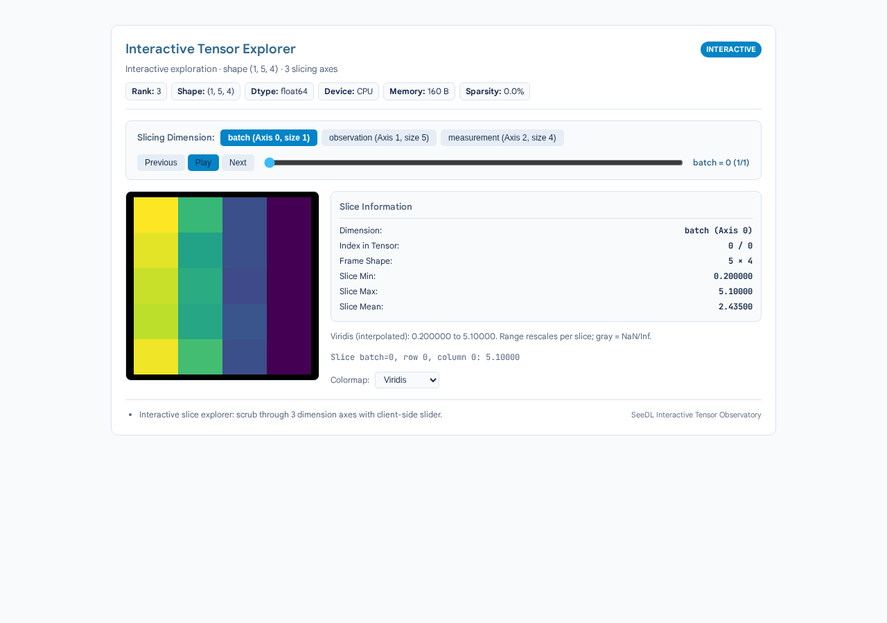 |
| Gradients, 390 px | 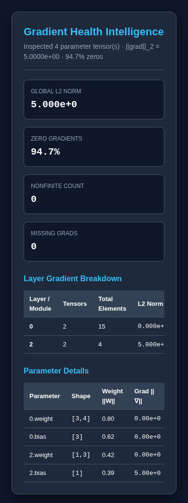 | 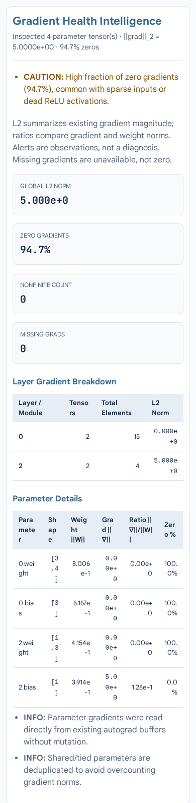 |
| Gradients, 1280 px | 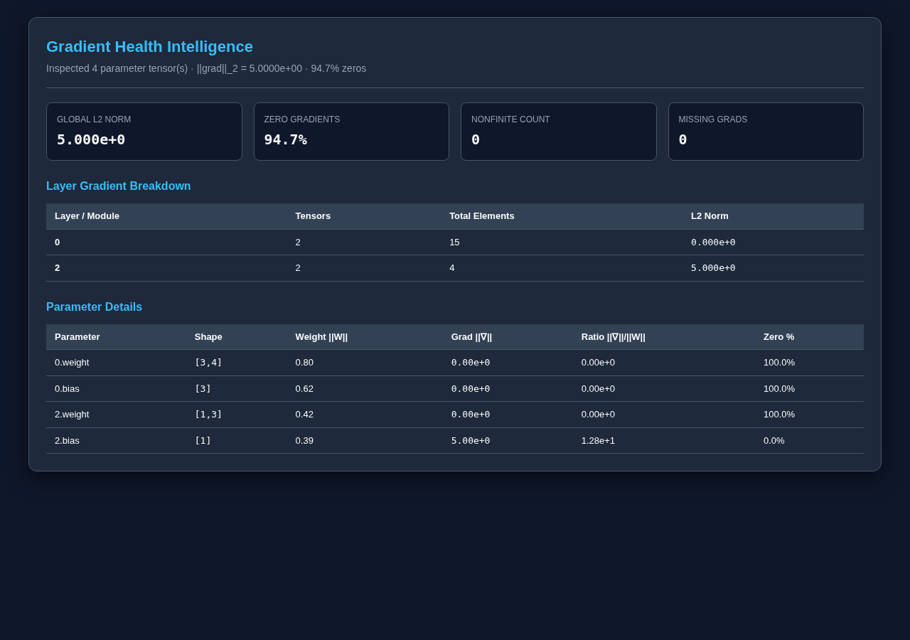 | 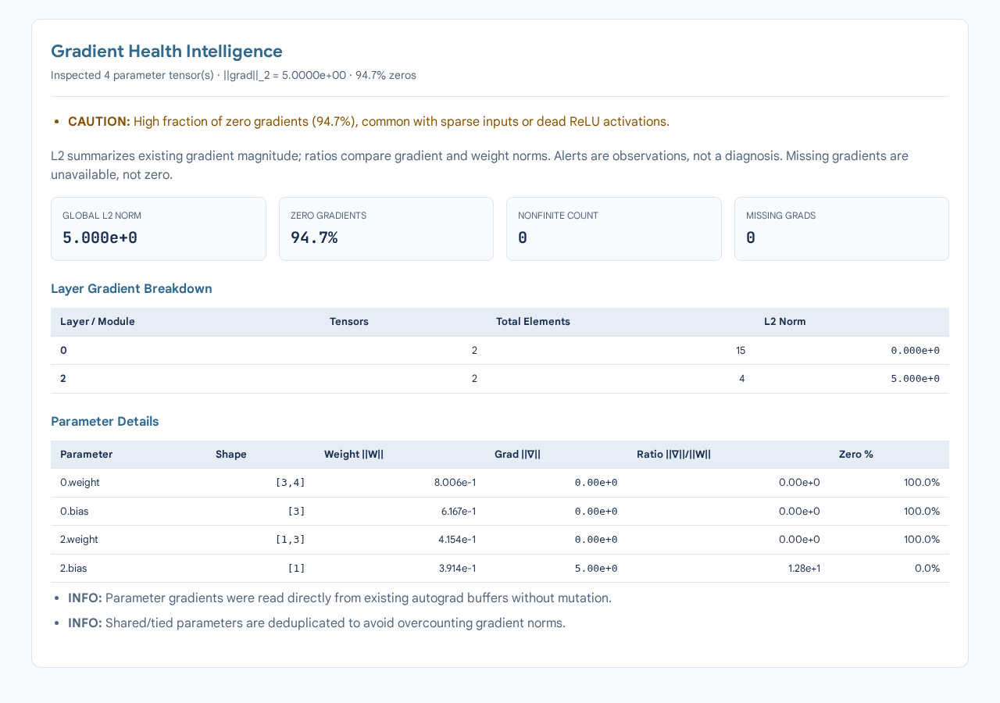 |

Browser checks cover 320, 390, 768 and 1280 px. The tensor document previously
measured 486 px wide at a 390 px viewport; it now fits at both 320 and 390 px.
Matrix, tensor, network, activations, attention, quantum and gradient exports
were generated and visually inspected. The small matrix switches to a semantic
value table on narrow screens instead of shrinking SVG text to unreadable sizes.

The website documentation uses the same self-hosted fonts:
[desktop screenshot](visuals/website-docs-after-1280.png) ·
[mobile screenshot](visuals/website-docs-after-390.png).

## Actual verification

| Check | Actual result |
| --- | --- |
| Baseline `main`, all scientific extras | 767 passed, 30 skipped, 2 warnings; 50.14 s. Chromium installation completed after collection. Ruff/mypy passed. |
| Baseline browser follow-up | The physical pointer/camera test and RGB tensor tooltip test passed on untouched `01ff054`. |
| Final full suite, Python 3.12.14, CPU extras + Chromium | **851 passed, 6 skipped, 2 warnings; 116.49 s.** All original tests retained. |
| New/affected boundary checks | 74 passed in the focused font/export/discovery/browser/report run, including the existing compact raw-SVG bound. |
| Clean wheel, Python 3.10.22 / 3.11.17 / 3.12.14 / 3.13.5 | **41 passed, 8 skipped per interpreter** (optional frameworks absent). Console script/module help, doctor, examples, demo, SVG/HTML, lazy imports and bundled font resources checked outside the repository. Zero unconditional dependencies confirmed from installed metadata. |
| Clean source distribution, Python 3.12 | Installation and installed console-script help passed. |
| Ruff, Ruff format, mypy | Passed; mypy checked 53 source files. |
| Lockfile and whitespace | `uv lock --check` and `git diff --check` passed. |
| Build/distribution | Wheel + sdist built; Twine strict checks and `scripts/verify_release.py --check-dist` passed. Version remains 0.6.0. |
| Website generation/static checks | Generated using installed published 0.6.0 as required by the existing generator. 190 local links/assets, 30 demo hashes, 16 recorded passes, scientific provenance and 42 Python examples passed. |
| Website browser checks | `scripts/verify_website.py` passed navigation, theme, native viewers, physical neuron pointer/camera interactions, training/quantum playback, mobile controls, lazy runtime, and zero browser/HTTP errors. |
| Visual/font checks | Screenshots at 320/390/768/1280 px; no horizontal page overflow in representative exports. Actual Google Sans and JetBrains Mono FontFace loading verified offline in exports and website docs, with no HTTP font requests. |

The two final warnings are the installed AnyIO pytest plugin's deprecation
warning and PyTorch's existing sparse-invariant warning. No tests were removed
or weakened to obtain these results. Native accelerator checks account for all
six skips in the full suite.

## Compatibility and limits

- All 36 existing public operations and their parameters remain available. `guide()` and `to_text()` are additive.
- Text, chart colors, fonts and HTML structure intentionally change. Consumers parsing exact `str(view)` output should use `.data`/`.metadata` instead. Summary mode bounds metadata and layer/value previews, with full detail available explicitly; warnings and sampling/provenance notes remain visible.
- Implicit script printing remains. An unchanged SVG `.show()` does not repeat it; explicit `print(view.to_text())` always prints. Terminal IPython now follows terminal behavior, while notebook kernels use rich display. Explicit Plotly/Matplotlib `.show()` retains backend behavior.
- No numerical algorithms, sampling budgets, autograd behavior or device transfers were changed. Existing engine tests and the new capture-reuse regression check numerical payloads, state restoration and one forward execution.
- CUDA/ROCm/MPS hardware was unavailable. Accelerator tests skip; actual GPU peak-memory behavior and drivers were not measured. Native Windows/PowerShell execution was not available; ASCII and CP1252 streams plus non-TTY/narrow-terminal behavior were tested.
- Full scientific/browser testing ran on Python 3.12. Clean core-only wheel/discovery testing ran on 3.10–3.13; this does not claim a full scientific-extra matrix on all four interpreters.
- Notebook behavior was checked with mocked kernel/display objects and actual MIME bundles, rather than a live Jupyter server.
- Terminal fonts and GitHub-rendered Markdown are controlled by their hosts. SeeDL-controlled UI/docs use Google Sans and JetBrains Mono; unsupported glyphs use platform fallbacks. Embedded fonts increase export size, while raw cached SVG stays within its existing compactness bound.
- No package version bump, release publication, website deployment or merge into `main`.
